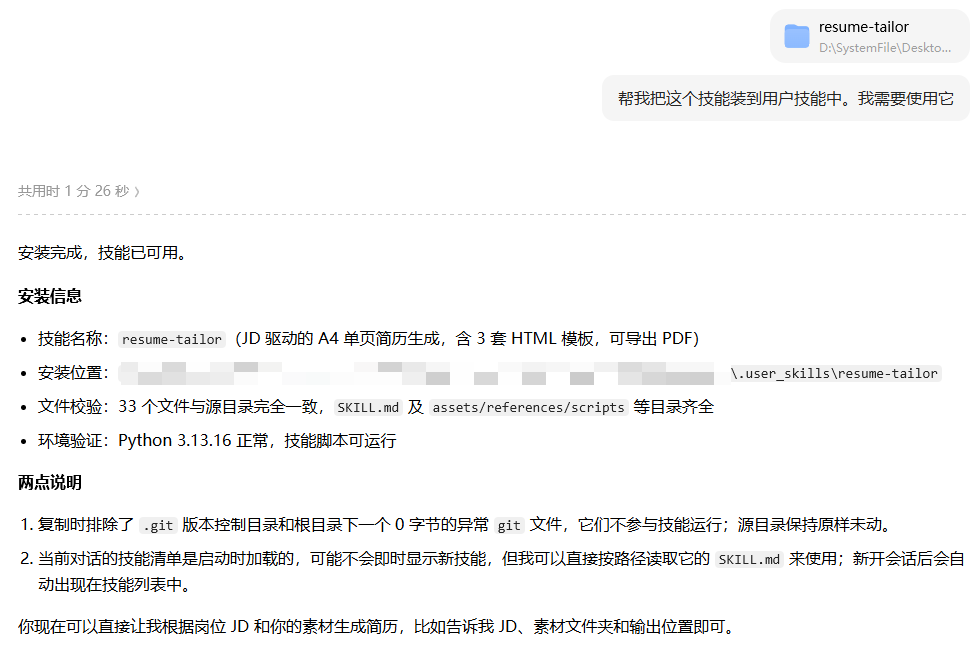
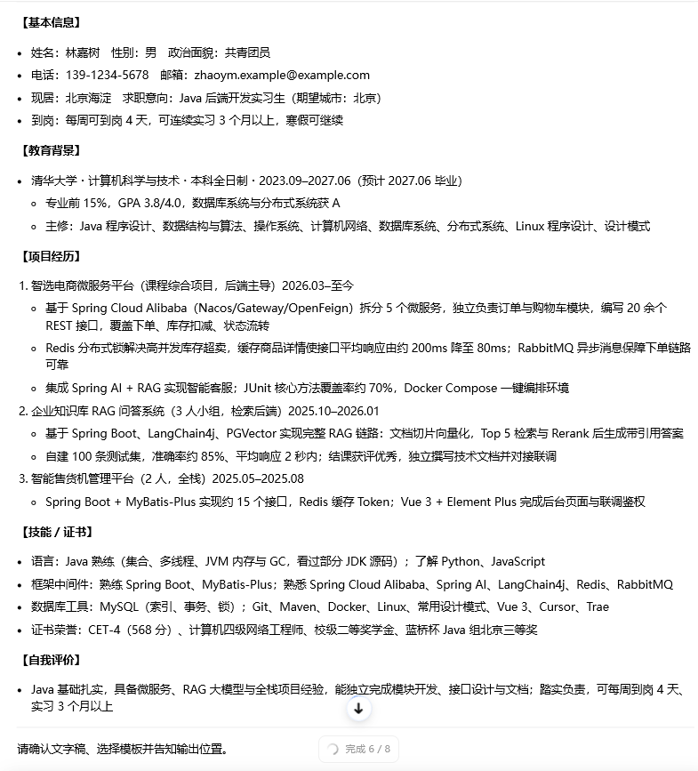
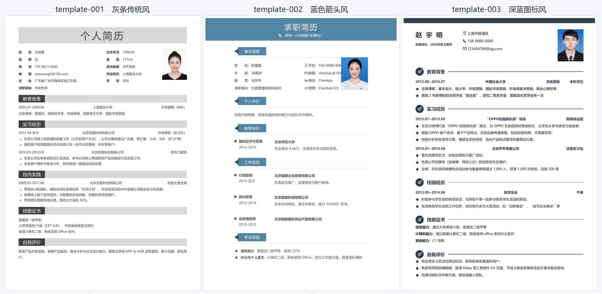
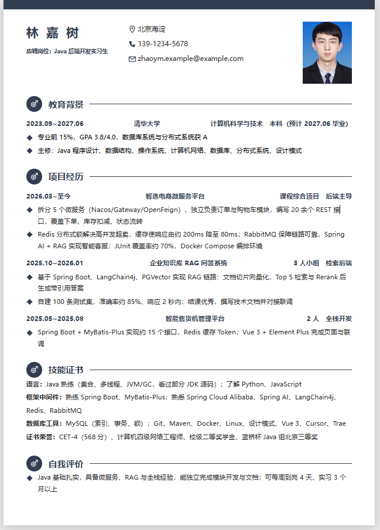
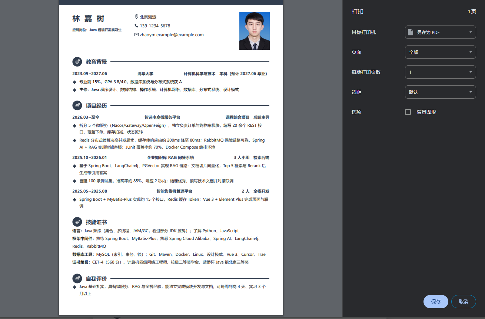
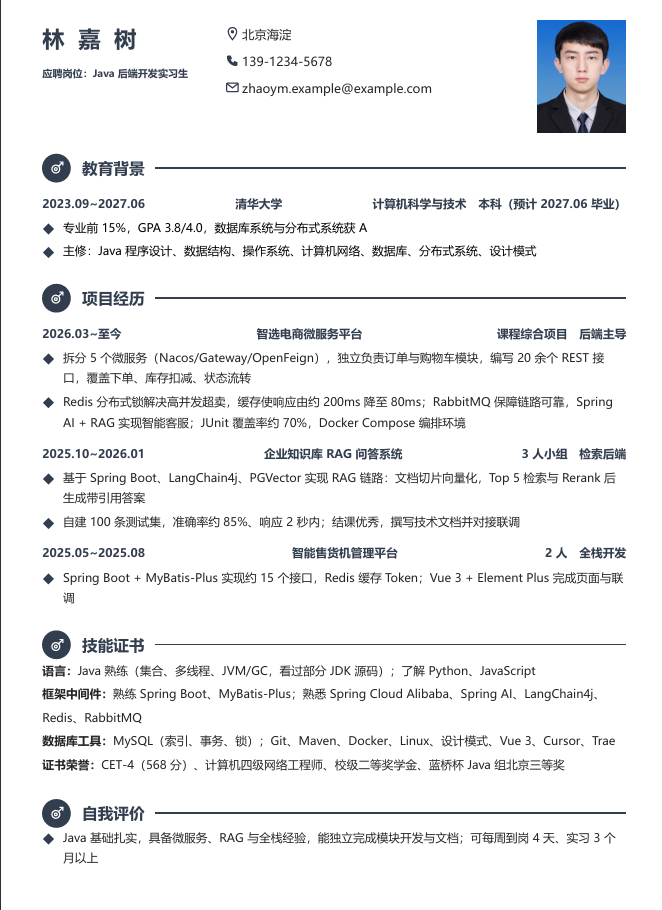
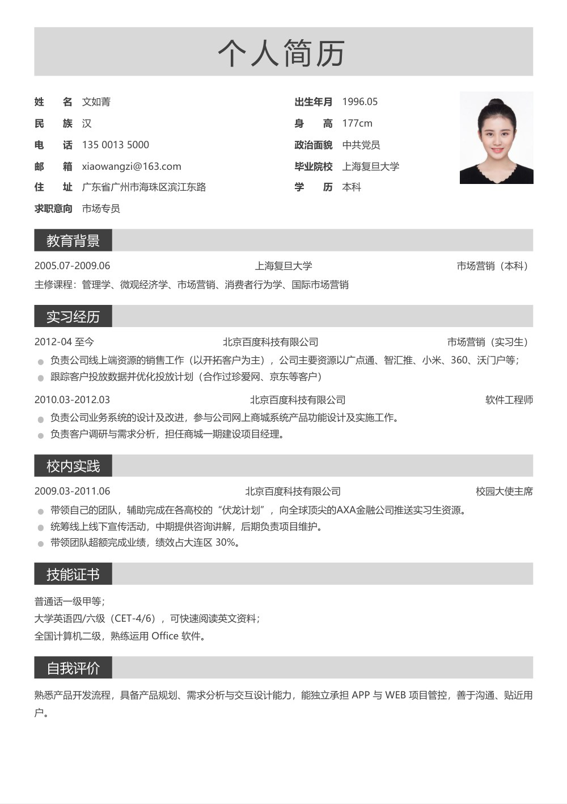
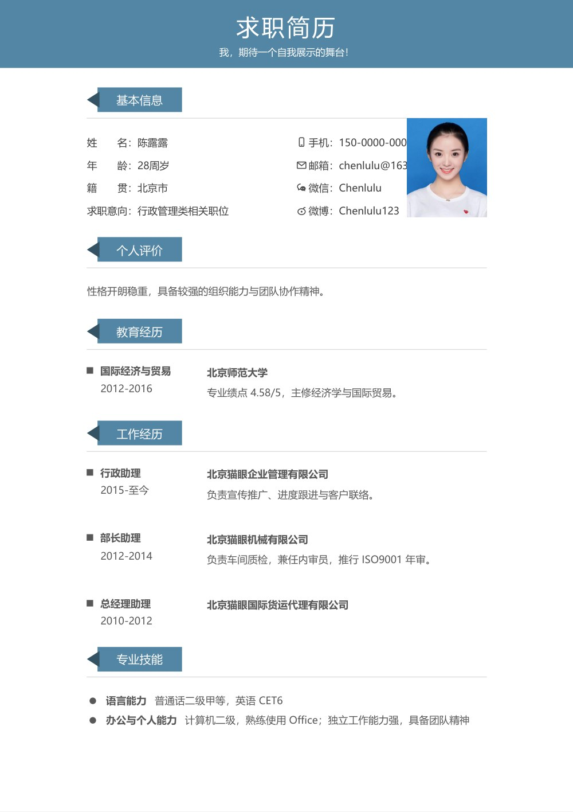
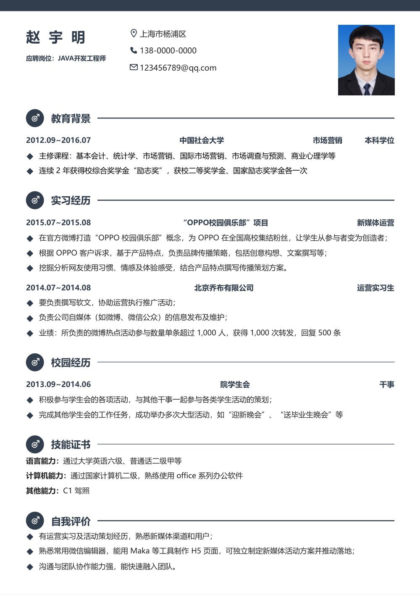

# Resume Tailor

> 把一份 JD 和你的真实素材，变成一份**针对性 A4 单页简历**。
> 面向 AI Agent 的 Skill（技能），基于开放的 [Agent Skills](https://agentskills.io) 协议。

[](LICENSE)
[](https://www.python.org/)
[](https://agentskills.io)

---

## 目录

- [它解决什么问题](#它解决什么问题)
- [安装](#安装)
- [使用流程](#使用流程)
- [模板一览](#模板一览)
- [命令速查](#命令速查)
- [常见问题](#常见问题)
- [环境要求](#环境要求)
- [目录结构](#目录结构)
- [已知限制](#已知限制)
- [协议与致谢](#协议与致谢)

---

## 它解决什么问题

直接让 AI「根据 JD 写份简历」，常见结果是：编造经历、套话连篇、一页塞不下、或者把模板里的示例姓名忘改。

Resume Tailor 把这件事拆成一套**有校验兜底**的流程：

| 常见问题 | 这个技能的应对 |
| --- | --- |
| 编造经历、数据、证书 | 素材里没有就不写；硬门槛缺失时明确告知风险 |
| 素材不全，AI 自己脑补 | 一次性列出缺口（姓名 / 联系方式 / 教育背景），由你决定补什么 |
| 在 HTML 里反复改文字 | **先出文字稿确认，再填 HTML**——改文字的成本只有改 HTML 的 1/10~1/20 |
| 忘了替换模板示例 | 模板是**空骨架**，正文全空，不存在"忘替换"这回事 |
| 内容超出一页 | `check_all.py` 渲染后数页数，超了直接报错 |
| PDF 导出多出白边 / 页眉 | 内置标准 A4 `@page` 规则，并按你的设置手动打印即可 |

核心原则：**所有反复修改都发生在文字稿阶段，HTML 只写一次。**

---

## 安装

本技能遵循开放的 [Agent Skills](https://agentskills.io/specification) 协议，可在任何 skills-compatible 的 AI agent runtime 中运行。

### 方式一：让 AI 安装（推荐）

打开你正在使用的 agent，直接说：

```text
帮我安装这个 skill：https://github.com/RiKeep/resume-tailor
```

以豆包为例：



### 方式二：手动克隆

把仓库克隆到对应 runtime 的 `skills/` 目录：

| Runtime | 安装路径 |
| --- | --- |
| Claude Code | `~/.claude/skills/resume-tailor/` |
| Codex CLI | `~/.codex/skills/resume-tailor/` |
| 豆包 | `~/.user_skills/resume-tailor/` |
| 其他 runtime | 对应 runtime 的 `skills/` 目录 |

```bash
git clone https://github.com/RiKeep/resume-tailor.git ~/.claude/skills/resume-tailor
```

> 即使 runtime 不支持自动加载，也可以直接把 `SKILL.md` 的内容粘贴进对话——它本质上就是一份带 YAML frontmatter 的 Markdown。

### 安装后自检（推荐）

确认环境可用、三个模板都还是 A4 单页：

```bash
cd ~/.claude/skills/resume-tailor
python scripts/check_layout.py --self-check
```

期望输出：

```text
template-001: [OK] 1 页，页面 209.9x297.0mm（A4）
template-002: [OK] 1 页，页面 209.9x297.0mm（A4）
template-003: [OK] 1 页，页面 209.9x297.0mm（A4）
[OK] 全部 3 个模板均为 1 页且为 A4。
```

若返回 `[SKIP]` 并提示找不到 Chrome/Edge，说明本机无法做排版校验与 PDF 导出，**其余功能不受影响**。

---

## 使用流程

下面用仓库自带的一套虚构素材演示。想直接体验，把 `examples/sample-materials/` 当作素材文件夹即可：

```text
使用技能包中内置的示例来生成一份简历。
```


### 第一步：准备输入

| 项目 | 说明 |
| --- | --- |
| 岗位 JD | 从招聘网站复制的完整职位描述（文本或 txt 文件） |
| 素材文件夹 | 旧简历、项目说明、技能清单、证书照片等，支持 `.txt / .md / .docx / .pdf / 图片` |
| 输出目录 | 成品保存位置，建议按「公司-岗位」命名，如 `D:\求职\某科技-Java后端` |
| 证件照 | 可选。不提供则用模板默认照片，照片区块不会被删 |
| 目标页数 | 可选，默认 1 页。一页是校招/社招的主流区间 |

### 第二步：发起对话

```text
帮我根据岗位 JD 生成一份针对性简历。
JD 我直接贴给你：
（这里粘贴完整 JD）

我的素材文件夹：D:\求职\我的材料
输出目录：D:\求职\某科技-Java后端
证件照：D:\求职\photo.jpg（没有就用模板默认）
目标页数：1 页
```

### 第三步：读取素材，补齐缺口

AI 遍历素材文件夹，只记录**可核实的事实**（教育背景、时间、学校、项目、职责、技能、证书、数据）。

**必填信息缺失时**（姓名、联系方式、教育背景），它会一次性列出所有缺口，并让你三选一：

1. 现在补上
2. 先用占位跑通，后续自己改文件
3. 确认跳过该区块

它不会自己编造。素材之间互相矛盾时会先问你，也不猜测。

### 第四步：查看并确认文字稿（关键步骤）

AI 先拆解 JD 建立匹配矩阵，再把内容写成一份**与模板无关的文字稿**，直接贴在对话里供你逐条审阅：

```text
【基本信息】
- 姓名：林嘉树
- 电话 / 邮箱：139-1234-5678 / …
- 求职意向：Java 后端开发实习生

【教育背景】
- 清华大学 · 计算机科学与技术 · 2022.09–2026.06
  - 主修课程：…

【实习/工作经历】
- 某公司 · 后端实习生 · 2025.07–2025.09
  - 基于 Spring Boot 独立完成订单模块 8 个接口开发…
```

同时给出**字数与容量粗估**，提示是否会超出目标页数。



- 满意 → 进入下一步
- 不满意 → 直接说哪里改，AI 只重写文字稿，**不会碰 HTML**

渲染成 HTML 之后再改一个字，成本是这里的 10~20 倍。**所以这一步值得多花几分钟。**

### 第五步：选择模板

文字稿确认后，AI 会用**文字**列出三个模板的编号、风格与适配场景：

```text
template-001  灰条传统风  国企 / 事业单位 / 传统行业
template-002  蓝色箭头风  行政 / 职能 / 运营 / 市场 / 人力
template-003  深蓝图标风  技术岗（Java / 开发 / 互联网）
```

回复编号即可，例如 `我选 template-003`。

> AI 默认**不会主动发送预览图**。想看效果就说「给我看看三个模板」。



**为什么先确认内容再选模板？** 三个模板的容量差异明显（`002` 最小、`003` 最大），同一份内容换模板就可能从「刚好一页」变成「溢出到第二页」。先定内容、后配版式，返工最少。

### 第六步：填充并校验

AI 复制空骨架模板、把文字稿映射进去、替换照片，然后跑一条命令：

```bash
python scripts/check_all.py "D:\求职\某科技-Java后端\resume.html" --expect 1
```

`--expect` 填你在第一步确认的目标页数。它会依次检查：

1. **静态校验**——是否还有没填的正文容器、占位标记、失效图片引用
2. **排版校验**——渲染后页数是否等于目标页数、页面是否为 A4

超页时 AI 只精简文字，不会调字号或页边距。全部通过后，**只交付 `resume.html` 一个文件**。



### 第七步：导出 PDF

**推荐手动导出**（零依赖，不挑环境）：

1. 用 Chrome / Edge 打开 `resume.html`
2. 按 `Ctrl+P`（macOS 为 `Cmd+P`）
3. 目标选择 **「另存为 PDF」**
4. 纸张选 **A4**
5. 边距选 **「无」**
6. **取消勾选「页眉和页脚」**



> 第 4–6 步很关键：边距不为「无」会把内容挤到第二页；页眉页脚会额外打印出标题和 URL。

也可以让脚本自动生成：

```bash
python scripts/html_to_pdf.py "D:\求职\某科技-Java后端\resume.html"
```

脚本会调用系统 Chrome/Edge，在 HTML 同目录输出 `resume.pdf`：



---

## 模板一览

| 模板 | 风格 | 适配场景 |
| --- | --- | --- |
| `template-001` | 灰条传统风 | 国企 / 事业单位 / 传统行业，或需要民族、政治面貌、身高字段的岗位，最通用稳妥 |
| `template-002` | 蓝色箭头风 | 行政 / 职能 / 运营 / 市场 / 人力等，现代清爽、设计感强 |
| `template-003` | 深蓝图标风 | 技术岗（Java / 开发 / 互联网），姓名突出、简洁专业 |

### template-001 灰条传统风



### template-002 蓝色箭头风



### template-003 深蓝图标风



> 预览图展示的是**填写后**的效果；仓库里的 `resume.html` 本身是空骨架。

---

## 命令速查

```bash
# 1) 从模板建立工作副本（可选 --photo 直接带入证件照）
python scripts/init_from_template.py --template template-003 \
    --output "D:\求职\某科技-Java后端" --name resume --photo "D:\求职\photo.jpg"

# 2) 手动填完后，一条命令跑完静态 + 排版校验
python scripts/check_all.py "D:\求职\某科技-Java后端\resume.html" --expect 1

# 3) 导出 PDF（也可用浏览器 Ctrl+P 手动导出）
python scripts/html_to_pdf.py "D:\求职\某科技-Java后端\resume.html"
```

| 脚本 | 作用 | 常用参数 |
| --- | --- | --- |
| `check_all.py` | **推荐入口**：静态 + 排版一次跑完 | `--expect N` `--browser PATH` `--self-check` |
| `init_from_template.py` | 复制空骨架模板到输出目录 | `--template` `--output` `--name` `--photo` |
| `check_resume.py` | 静态校验：漏填容器、占位标记、失效引用 | — |
| `check_layout.py` | 排版校验：页数 + 页面尺寸 | `--expect` `--pdf` `--browser` `--self-check` |
| `html_to_pdf.py` | 调用系统浏览器转 A4 PDF | `--pdf` `--browser` |

**退出码**：`0` 通过 / `1` 校验未通过 / `2` 输入错误 / `3` 环境不具备（无浏览器，需人工核对）。

> `3` 是刻意设计的：**环境不具备时绝不输出 `[OK]`**，避免"看起来通过了、其实没检查"。

---

## 常见问题

**Q：交付的是一个文件还是两个？**
对话里只交付 `resume.html` 一个文件。但 HTML 通过相对路径引用 `assets/photo.jpeg`，**移动或分享时请连同同级 `assets/` 目录一起**，否则照片会裂。

**Q：为什么打印出来多了一页空白 / 多了页眉？**
打印对话框里把「边距」设为**无**，并取消勾选「页眉和页脚」。模板已内置 `@page { size: A4; margin: 0 }`，但浏览器会以自己的设置为准。

**Q：能不能给我 Word（.docx）版？**
当前版本不提供。`sources/` 里的 docx 原件内容全部存放在 Word 文本框（txbxContent）中，程序化改写的可靠性不足。建议从 HTML 复制文字到 Word 自行排版。

**Q：目标页数能设成 2 页吗？**
可以，`--expect 2`。但要注意：分页不会自动均衡，内容通常在条目中间断开。而且一页是校招/社招的主流区间，内容确实撑得起两页时再考虑。

**Q：本机没有 Chrome / Edge 怎么办？**
排版校验会返回 `[SKIP]`（退出码 3），PDF 导出也不可用。此时请用任意浏览器打开 HTML 人工核对；静态校验与模板填充仍然正常。也可用 `--browser` 指定其他 Chromium 系浏览器。

**Q：可以用自己的照片吗？**
可以。`--photo <路径>` 会覆盖工作副本里的 `assets/photo.jpeg`。不提供则保留模板默认照片，照片区块不会被删除。

---

## 环境要求

- **Python 3.8+**：全部脚本只依赖标准库，无需 `pip install`。
- **Chrome / Edge / Chromium**：仅 PDF 导出与排版校验需要。脚本会自动探测 Windows / macOS / Linux 常见安装位置，也可用 `--browser` 显式指定。
- **pypdf（可选）**：若已安装，`check_layout.py` 会优先用它读取 PDF；未安装时自动回退到内置解析，不影响使用。

---

## 目录结构

```text
resume-tailor/
├── SKILL.md                       # 技能主入口：触发条件与端到端工作流程
├── README.md
├── LICENSE
├── assets/                        # 输出用资源（空骨架模板，均为 A4 单页）
│   ├── template-001/
│   │   ├── resume.html            # 空骨架：有版式与区块标题，正文全空
│   │   ├── preview.jpg            # 预览图（填写后的效果）
│   │   └── assets/photo.jpeg      # 默认证件照
│   ├── template-002/              # 同上
│   └── template-003/              # 同上
├── sources/                       # 模板 docx 原件（仅供改版式/重制，不参与生成）
│   ├── 001.docx
│   ├── 002.docx
│   ├── 003.docx
│   └── README.md
├── references/                    # 方法论文档（按需加载，不预读）
│   ├── example-template-001.html  # 已填写样例：判断内容密度用，勿直接复制
│   ├── example-template-002.html
│   ├── example-template-003.html
│   ├── jd-analysis.md             # JD 拆解与关键词匹配
│   ├── resume-writing.md          # 真实性红线、STAR / 量化写法
│   └── template-guide.md          # 模板结构与版式保护规则
├── scripts/                       # 确定性脚本（纯标准库）
│   ├── init_from_template.py
│   ├── check_all.py
│   ├── check_resume.py
│   ├── check_layout.py
│   └── html_to_pdf.py
├── examples/                      # 演示截图与测试素材
│   ├── 01-文字稿确认.png
│   ├── 02-模板选择.png
│   ├── 03-HTML成品.png
│   ├── 04-PDF效果.png
│   ├── PDF打印界面.png
│   └── sample-materials/          # 一套虚构素材（含测试 JD），可直接体验
└── image/                         # README 安装演示截图
```

---

## 已知限制

- **不提供 docx 导出**：原因见上方 FAQ。
- **排版校验依赖本机浏览器**：无 Chrome/Edge 时只能人工核对（会明确告知，不会假通过）。
- **模板只有三套**：且均基于国内常见简历版式，英文简历、学术 CV 不在覆盖范围内。
- **不做投递**：只生成文件，不代填网申系统。

---

## 协议与致谢

本项目基于 **MIT License** 开源（见 [LICENSE](LICENSE)），允许个人与商业用途的使用、复制、修改和分发，只需保留原始版权与许可声明。

内置简历模板的**设计复刻自** [mmmlllnnn/ResumeCollection](https://github.com/mmmlllnnn/ResumeCollection)（MIT License），模板版权归原作者所有。本项目将其中的 docx 模板重制为 HTML 版本，并在此基础上构建了 JD 驱动的生成流程。感谢原作者的模板收集与分享。

---

## 维护者备注

<details>
<summary>改模板后如何重新生成预览图（非使用者必读）</summary>

1. 修改 `assets/template-00X/resume.html` 后，先确认仍是 A4 单页：

   ```bash
   python scripts/check_layout.py --self-check
   ```

2. 用脚本把 HTML 转 PDF，再把第 1 页导出为图片，覆盖 `preview.jpg`。

3. 如需顺带更新 `examples/` 下的成品演示图，同样从真实渲染结果导出，**不要手工截屏**——手工截图会受窗口尺寸和缩放影响，与脚本产出不一致。

</details>
